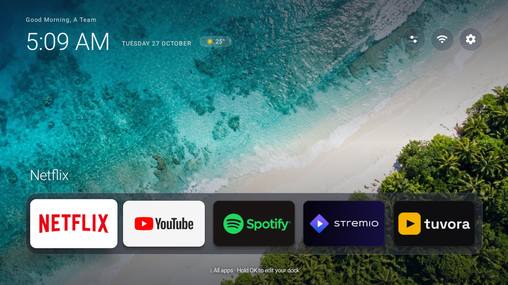
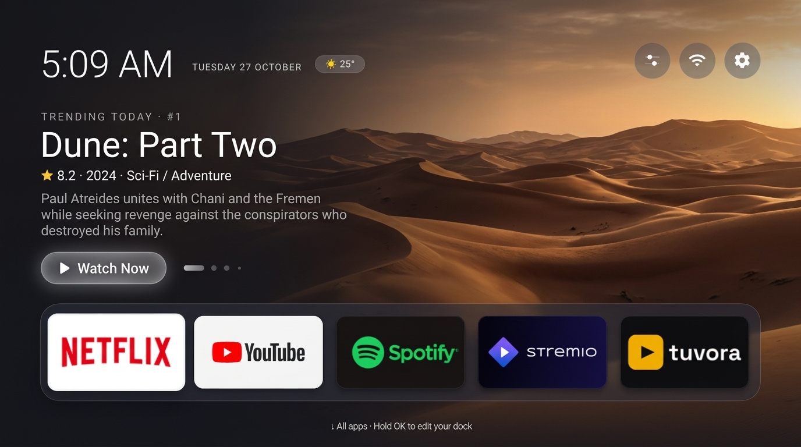
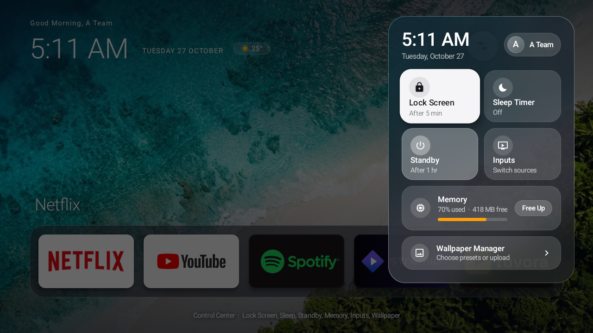
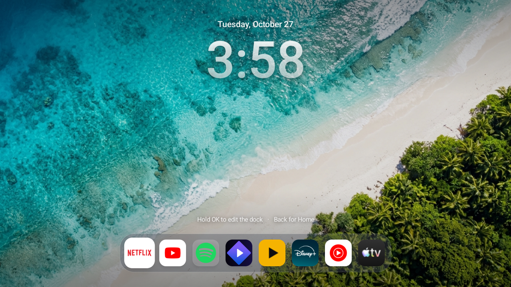
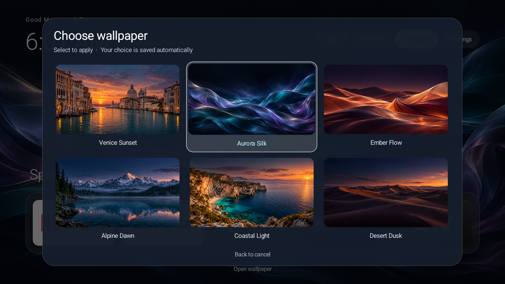
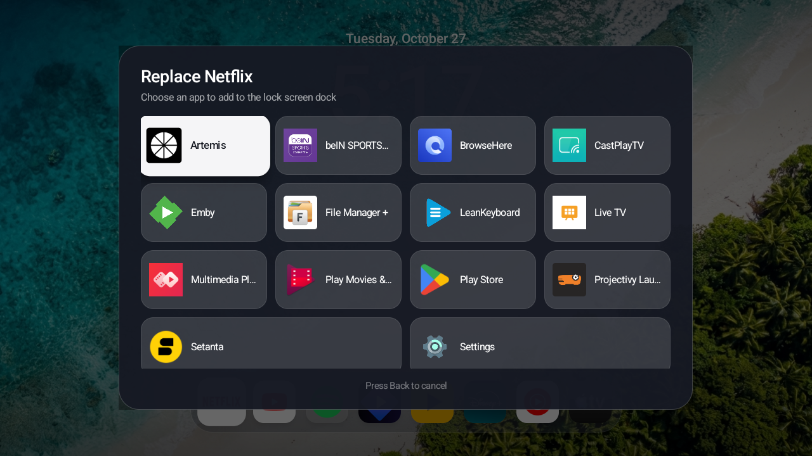

# TV Launcher 📺✨

> A minimalist, fluid, Apple TV / tvOS-inspired launcher designed for Android TV and Google TV devices. Built from the ground up in pure Java with zero third-party runtime dependencies, optimized specifically for smooth performance on resource-constrained TV hardware.

[-3DDC84?style=flat-square&logo=android&logoColor=white)](https://developer.android.com)
[](LICENSE)
[](launcher/app/build.gradle)

---

## 📸 Showcase

### Home Screen & Now Showing Hero (TMDB Trending)
| Clean Home Screen (Static Wallpaper) | Now Showing Hero (Dynamic TMDB Backdrop & Watch Now) |
| :---: | :---: |
|  |  |

### Control Center & Lock Screen
| Apple TV Liquid Glass Control Center | glassOS Centered Lock Screen |
| :---: | :---: |
|  |  |

### Wallpaper Manager & App Dock Picker
| 12 Curated HD Wallpaper Presets | 4-Column Visual App Selector |
| :---: | :---: |
|  |  |

---

## ✨ Key Features

- **🎬 Now Showing (TMDB Trending Hero)**:
  - Dynamic crossfading TMDB "Trending Today" backdrops replacing the static wallpaper behind the home UI.
  - Displays title, IMDb/TMDB rating, release year, overview synopsis, and a smart **Watch Now** button.
  - **Smart Routing**: Launches installed streaming apps (Netflix, Disney+, Apple TV+, Prime Video, Max) matching TMDB watch providers → Stremio details page via IMDb ID → YouTube trailer.
  - Built-in performance safeguards: RGB_565 decoding, disk caching, and rotation pauses whenever the screen is not active.

- **🍎 tvOS Liquid Glass Control Center**:
  - Translucent frosted glass panel with real-time dynamic background blur powered by an optimized O(N) StackBlur algorithm (`FastBlur.java`).
  - Slide-down / slide-up entrance animation triggered from the circular top-right header button.
  - Quick-access tiles: **Lock Screen timeout**, **Sleep Timer**, **Standby mode**, **Input switcher (HDMI 1, 2, AV, Tuner)**, and **One-tap Memory Cleaner**.

- **🔒 glassOS Centered Lock Screen**:
  - Mathematically centered tabular clock and date layout with subtle Ken Burns background motion.
  - Fully customizable quick-launch dock with favorite apps.
  - Long-press any dock tile to enter edit mode: Move Left/Right, Replace with Another App, or Add New Apps from a 4-column visual icon grid.

- **🖼️ Wallpaper Manager & Local Wi-Fi Upload Server**:
  - 12 built-in high-resolution wallpapers.
  - Built-in lightweight HTTP server on port `7070` (`http://<tv-ip>:7070`): upload custom wallpapers directly from any phone, tablet, or PC browser without needing flash drives or file managers.

- **🌤️ Live Weather & Sleep Badges**:
  - Live weather pill in the header displaying current temperature and weather conditions (via IP geolocation and Open-Meteo, cached with 2-hour TTL).
  - Sleep timer countdown badge (e.g., `🌙 29m`) in the header with one-click cancellation.

- **⚡ Lightweight & Pure Native**:
  - Zero heavy third-party UI or reactive libraries.
  - Low memory footprint (~40 MB RAM) ensures 60 FPS fluidity on budget smart TVs.

---

## 🚀 Installation & Setup

### Prerequisites
- **Computer** with Windows, macOS, or Linux.
- **Java JDK 17+** installed and set in your `PATH`.
- **Android SDK** (API 34 platform & build-tools) installed.
- **ADB** (Android Debug Bridge) installed.

---

### Step 1: Clone the Repository
```bash
git clone https://github.com/slever1n/TV-Launcher.git
cd TV-Launcher
```

---

### Step 2: Configure TMDB API Key (Optional)
To enable the **Now Showing** trending movie backdrops, supply a free TMDB API key:

1. Copy the example configuration file:
   ```bash
   # On Windows (cmd/PowerShell):
   copy launcher\local.properties.example launcher\local.properties

   # On macOS/Linux:
   cp launcher/local.properties.example launcher/local.properties
   ```
2. Open `launcher/local.properties` and replace `YOUR_TMDB_API_KEY` with your actual v3 API key or v4 read access token from [The Movie Database](https://www.themoviedb.org/settings/api):
   ```properties
   tmdb.apiKey=your_actual_api_key_here
   ```
> *Note: If you do not provide a key, the launcher simply uses the static wallpaper and the Now Showing toggle will indicate that an API key is required.*

---

### Step 3: Build the APK
Use the Gradle wrapper inside the `launcher` directory:

#### On Windows:
```cmd
cd launcher
gradlew.bat assembleDebug
```

#### On macOS / Linux:
```bash
cd launcher
chmod +x gradlew
./gradlew assembleDebug
```

The compiled APK will be generated at:
```text
launcher/app/build/outputs/apk/debug/app-debug.apk
```

---

### Step 4: Install onto Your Android TV

1. **Enable Developer Options & Network Debugging on your TV**:
   - Go to **Settings** → **Device Preferences** → **About**.
   - Click **Build** 7 times until Developer Mode is unlocked.
   - Go to **Settings** → **Developer Options** and enable **Network Debugging** (ADB over Wi-Fi).

2. **Connect via ADB**:
   ```bash
   adb connect <YOUR_TV_IP>:5555
   ```
   *(Accept the authorization prompt on your TV screen if prompted)*

3. **Install the Launcher**:
   ```bash
   adb install -r launcher/app/build/outputs/apk/debug/app-debug.apk
   ```

---

### Step 5: Set as Default Launcher
Press the **Home** button on your remote control and select **TV Launcher** → **Always**.

*(Optional)* If your stock launcher does not show the prompt to switch default launchers, you can disable the stock Google TV launcher via ADB:
```bash
adb shell pm disable-user --user 0 com.google.android.apps.tv.launcherx
```

To re-enable it at any time:
```bash
adb shell pm enable com.google.android.apps.tv.launcherx
```

For a complete guide on safely debloating stock OEM background services, telemetry, and manufacturer ads, see [DEBLOAT.md](DEBLOAT.md).

---

## 🎮 Navigation & Remote Controls

| Screen | Action | Remote Key / D-Pad |
| :--- | :--- | :--- |
| **Home Screen** | Open All Apps Drawer | Press `Down` from dock |
| **Home Screen** | Jump to Header Controls | Press `Up` from dock |
| **Home Screen** | Open Control Center | Focus Control Center button → Press `OK` |
| **Dock** | Reorder or Replace App | Long-press `OK` on any dock app icon |
| **Hero (Now Showing)** | Focus Watch Now pill | Press `Down` from Header or `Up` from Dock |
| **Hero (Now Showing)** | Browse Trending Slides | Press `Left` / `Right` on Watch Now pill |
| **Lock Screen** | Unlock to Home | Press `Back`, `Up`, or launch an app from dock |
| **Control Center** | Close / Dismiss | Press `Back` (slides back up smoothly) |

---

## 🛠️ Companion Documentation

- [DEBLOAT.md](DEBLOAT.md) — Comprehensive list of safe-to-disable manufacturer packages, telemetry removal steps, and restore scripts for Android 14 TVs.

---

## 📄 License & Attribution

- Released under the [Apache License 2.0](LICENSE).
- This product uses the TMDB API but is not endorsed or certified by TMDB.